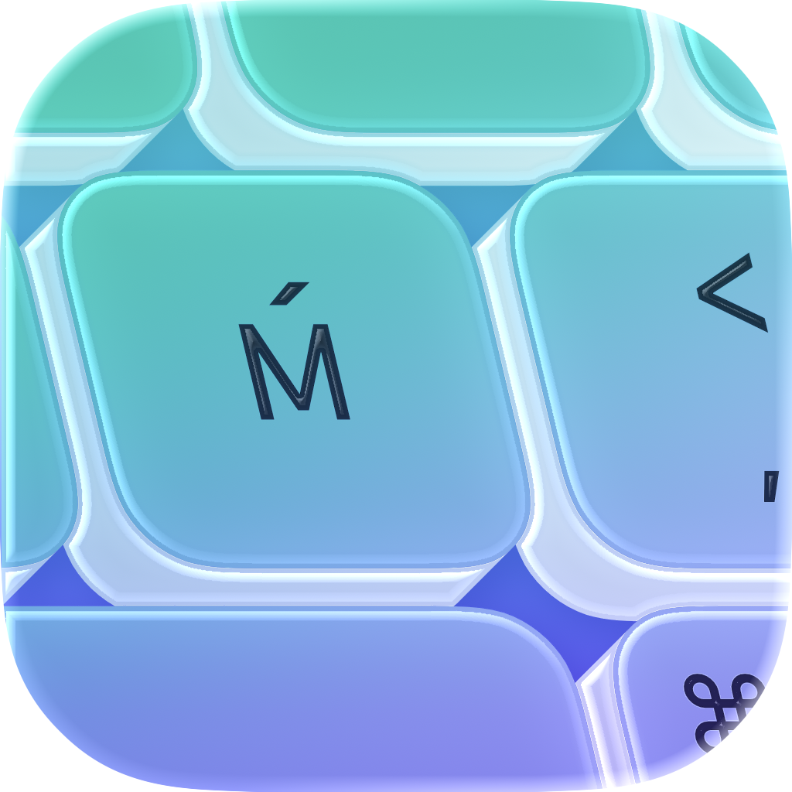
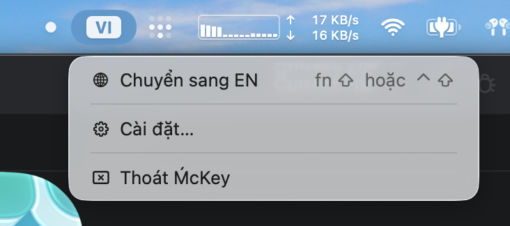
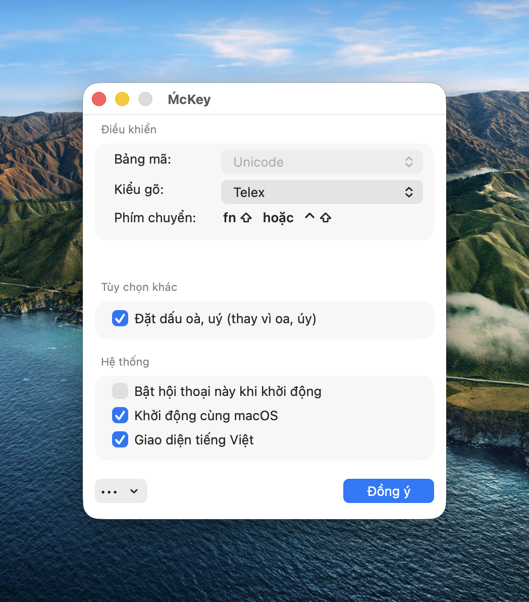

# MćKey – UniKey for macOS
### Bộ gõ tiếng Việt trên macOS không-IME dựa trên mã nguồn UniKey. Non-IME macOS Vietnamese input application based on UniKey.

- **Không lặp ký tự khi gõ `delete`** – Bạn từng bấm xoá văn bản, mà toàn bộ phần
  gạch dưới lặp đi lặp lạilạilạilạilạilại mỗi cú nhấp? Đây là lỗi IME (Input Method Editor) của macOS; 
  MćKey không dùng IME mà dùng macOS Accessibility API, tạo cảm giác gõ giống UniKey trên Windows.

- **No duplication-on-`delete` in text fields.** Ever pressed delete key on a text field only for the text 
  to duplicateduplicateduplicate on every delete. This is a macOS IME bug; MćKey bypass IME and
  use the macOS Accessibility API for authentic UniKey on Windows like feel.

## How it works

A `CGEventTap` intercepts each keystroke and runs it through the PHTV-derived
Vietnamese engine (Telex, VNI and simple Telex modes), which maintains the
current syllable and supports dictionary-based English restoration.

- If the keystroke just appends a character that is identical to what you typed
  (normal letter, no accent change), the event passes through natively. To the
  app, including its inline autocomplete, it looks exactly like a human typing.
- When a key adds/changes a diacritic (e.g. `s` → sắc tone, `aa` → â), the engine
  computes the new syllable, then deletes **only the changed suffix** (synthetic
  backspaces) and re-injects the replacement as a single atomic Unicode insert.

The engine supports selectable tone placement and five output code tables.

## Contribution

Always welcome!

## Attribution

[UniKey for Microsoft Windows](https://unikey.org) © Pham Kim Long, adapted under GPL license. Vietnamese composition and dictionary code also derives from [PHTV](https://github.com/PhamHungTien/PHTV) © Phạm Hùng Tiến under AGPLv3.

## License

McKey includes GPLv3-licensed UniKey-derived code and AGPLv3-licensed PHTV-derived code. The combined distribution must comply with both licenses, including the AGPLv3 terms. See [LICENSE.md](LICENSE.md), [LICENSE-AGPL-3.0.txt](McKey/LICENSE-AGPL-3.0.txt), and [THIRD_PARTY_NOTICES.md](THIRD_PARTY_NOTICES.md).

